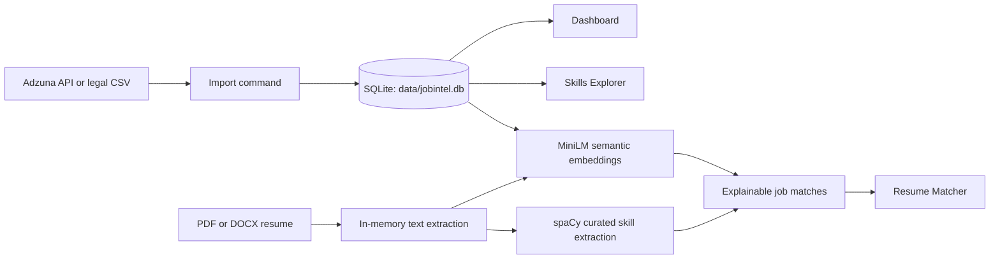

# JobIntel — Job Market Intelligence and Resume Matcher

JobIntel is a Streamlit portfolio project for exploring India-focused data and AI job postings, then comparing a resume against the jobs stored locally. It turns a legal job source or downloaded CSV into a small analytics workspace with transparent, explainable resume matches.

> **Data note:** The included CSV contains demo records so the app can run immediately. Screens label demo-backed views as **Sample data**. Replace it with an Adzuna API import or a legally obtained dataset before making market claims.

## What it demonstrates

- Data ingestion from the Adzuna public API or a local CSV fallback
- SQLite persistence with repeatable upserts
- In-app CSV validation and import, so roles and cities come from your dataset
- pandas analysis for skill demand, cities, salaries, and experience levels
- Streamlit multi-page UI with Plotly visualisations
- spaCy phrase matching for curated resume skills
- `all-MiniLM-L6-v2` sentence embeddings for explainable resume-to-job ranking
- Resume-guided outbound searches on LinkedIn, Indeed India, and Naukri without scraping
- pytest coverage for persistence, analytics, skill extraction, and matching logic

## Screenshots

Add your own screenshots after running the app. The placeholder folder is [docs/screenshots](docs/screenshots/README.md).

| Dashboard | Skills Explorer |
| --- | --- |
| `docs/screenshots/dashboard.png` | `docs/screenshots/skills-explorer.png` |

| Resume Matcher | About |
| --- | --- |
| `docs/screenshots/resume-matcher.png` | `docs/screenshots/about.png` |

## Architecture



## Project structure

```text
JobIntel/
├── app/
│   ├── main.py                    # Streamlit entry point and navigation
│   └── pages/                     # Data Manager, analytics, matching, and About pages
├── data/
│   └── raw/sample_jobs.csv        # Clearly labelled demo fallback
├── docs/screenshots/              # Add portfolio screenshots here
├── scripts/import_jobs.py          # API/CSV ingestion command
├── src/
│   ├── data/                      # SQLite, import, cache, and analytics modules
│   ├── ml/                        # Resume parsing, skills, and embeddings
│   └── ui/theme.py                # CSS and shared Streamlit components
├── tests/                         # Offline pytest suite
├── .env.example                   # Optional Adzuna credentials template
└── requirements.txt
```

## Run locally on Windows

### 1. Create a virtual environment

```powershell
cd "C:\Users\sutar\Documents\Codex\2026-11-14\github-plugin-github-openai-curated-remote"
py -3.12 -m venv .venv
.\.venv\Scripts\Activate.ps1
```

Python 3.10 or newer works. If PowerShell blocks activation, run:

```powershell
Set-ExecutionPolicy -Scope Process -ExecutionPolicy Bypass
```

### 2. Install packages

```powershell
python -m pip install --upgrade pip
pip install -r requirements.txt
```

### 3. Import jobs

Use the included demo data first:

```powershell
python scripts/import_jobs.py --source csv
```

For a downloaded dataset, its CSV needs `title` or `job_title` and can include fields such as `company`, `location`, salary values, `skills`, `description`, and `posted_date`:

```powershell
python scripts/import_jobs.py --source csv --csv "C:\path\to\jobs.csv"
```

You can also open **Data Manager** in the app, upload a CSV, review missing-title, duplicate, salary, and skills checks, then import it directly. This is the easiest way to expand beyond the demo's three roles and limited city list.

After you import your own data, use **Data Manager → Remove demo records** if you want dashboards and resume matches to use only your data.

For the Adzuna public API, copy `.env.example` to `.env`, enter your credentials, then run:

```powershell
python scripts/import_jobs.py --source adzuna --pages-per-role 1
```

### 4. Launch the app

```powershell
streamlit run app/main.py
```

The first Resume Matcher analysis downloads `all-MiniLM-L6-v2` if the model is not already cached locally.

After analysing a resume, open **Job Search Assistant** to create role- and skill-focused searches for LinkedIn Jobs, Indeed India, and Naukri. The app opens each platform's own search page; it does not scrape or copy their listings.

## Run tests

```powershell
pytest -q
```

The test suite uses a fake embedding model, so it does not download the sentence-transformer model or call external APIs.

## Data and privacy

- Job data: use Adzuna or a downloaded dataset whose license permits your use.
- No scraping: the project does not scrape job boards.
- Credentials: `.env` is excluded from Git. Never commit API keys.
- Resumes: uploads are read in memory for the active Streamlit session. The original file and its text are not written to SQLite or the project folder.
- Match scores: scores rank the jobs currently stored in your database. They are not a hiring prediction or a measure of candidate quality.

## Deploy on Streamlit Community Cloud

1. Create a GitHub repository and push this project, excluding `.env`, `.venv`, and local databases.
2. In [Streamlit Community Cloud](https://share.streamlit.io/), choose **Create app** and select your repository and branch.
3. Set the main file path to `app/main.py`.
4. In **Advanced settings → Secrets**, add Adzuna credentials only if you intend to use the API:

   ```toml
   ADZUNA_APP_ID = "your_id"
   ADZUNA_APP_KEY = "your_key"
   ```

5. Deploy. The app works without API secrets when the demo CSV has been imported locally, but a hosted app needs a deployed database or a collection step before it can show jobs.

For a public deployment, replace the local SQLite demo workflow with a managed database or a versioned, legally redistributable dataset. This keeps hosted data available across restarts.

## Weekly refresh automation

The repository includes [.github/workflows/weekly-refresh.yml](.github/workflows/weekly-refresh.yml). It runs every Monday at 02:00 UTC and can also be started manually from the **Actions** tab.

To enable it, add these repository secrets in **Settings → Secrets and variables → Actions**:

```text
ADZUNA_APP_ID
ADZUNA_APP_KEY
```

When credentials exist, the workflow imports fresh Adzuna records and uploads `data/jobintel.db` as a 14-day workflow artifact. It does not commit data back to the repository, which avoids automatically publishing API-derived records. Download the artifact when you need the refreshed local database, or connect a managed database before expecting a hosted app to retain scheduled data.

## Interview talking points

- **Why SQLite first?** It makes the project easy to run, inspect, and test locally. The data access layer keeps a future PostgreSQL migration contained.
- **Why a CSV fallback?** It removes the API-key barrier for demos and makes the ingestion flow reproducible.
- **Why combine embeddings and skill overlap?** Embeddings capture resume context, while exact skill overlap gives users concrete reasons behind each match.
- **Why show missing skills?** A ranking is more useful when it produces an action list for the candidate.
- **How did you prevent misleading dashboards?** Every displayed figure is calculated from the local database, sample data is labelled, and unavailable fields render as missing rather than estimated.
- **What would you improve next?** Add job-description skill extraction, scheduled collection with source provenance, a managed database for deployment, and evaluation data for match-quality measurement.

## License

Choose a license before publishing. MIT is a common choice for portfolio projects.
# jobintel-ai-job-market-resume-matcher

